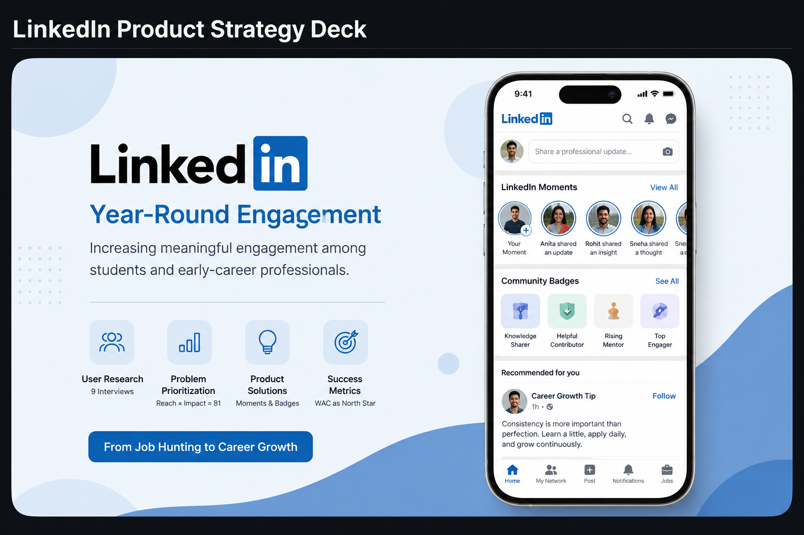

LinkedIn  Product  Strategy Deck


# LinkedIn Product Strategy Deck




## Overview

This project presents a **Product Strategy and User Research Case Study** focused on increasing year-round engagement among students and early-career professionals on LinkedIn.

The project combines **user research, competitive analysis, personas, journey mapping, pain-point prioritization, product strategy, solution design, and success metrics**.

---

## Objectives

- Understand LinkedIn's engagement gap.
- Identify user pain points through research.
- Analyze competitors and engagement behavior.
- Develop user personas and journey maps.
- Prioritize problems using Reach × Impact.
- Propose product solutions to increase meaningful engagement.
- Define measurable success metrics.

---

## Key Research Findings

**9 users were interviewed:**

- **7/9** reported reduced usage after getting an offer.
- **4/9** felt LinkedIn is more about showcasing success.
- **6/9** felt the feed contains self-promotion instead of useful content.
- Only **2/9** found LinkedIn meaningful for long-term professional value.

### Key Pain Points

- Achievement-heavy content
- AI-generated content
- Notification noise
- Low-quality feed content
- Pressure to post something "impressive"
- Limited reasons to return after getting a job

---

## Problem Prioritization

Using a **Reach × Impact approach derived from the RICE framework**, the highest-priority problem was:

> **Sharing feels forced due to pressure to post something "impressive."**

**Reach: 9/10 | Impact: 9/10 | Score: 81/100**

---

## Proposed Solutions

### ⏳ LinkedIn Moments

A proposed **24-hour disappearing sharing format** designed to make professional sharing more casual and low-pressure.

**Goal:** Reduce the "nothing big enough to post" barrier and encourage authentic, frequent sharing.

### 🏆 Community Badges

A proposed **peer-validated recognition system** that rewards meaningful contributions.

**Contribution Loop:**

`Contribute → Get Verified → Earn Badge → Build Reputation`

**Goal:** Move users from passive scrolling toward meaningful contribution and professional credibility.

---

## Product Strategy

```text
Reduce Posting Anxiety
        ↓
Enable Casual Sharing
        ↓
Increase Contribution
        ↓
Reward Meaningful Participation
        ↓
Build Long-Term Engagement
```

### Product Vision

**From:** "I use LinkedIn when I need a job."

**To:** "I use LinkedIn to continuously grow my career."

---

## Success Metrics

### North Star Metric
**Weekly Active Contributors (WAC)**

### LinkedIn Moments
- Adoption Rate
- New-Poster Activation
- Creator Repeat Rate
- Viewer Engagement Rate

### Community Badges
- Contribution Rate
- Activation Rate
- Contributor Retention
- Badge Earn Rate

---

## Tools & Skills

**User Research | Competitive Analysis | User Personas | Journey Mapping | RICE Framework | Product Strategy | Product Design | Product Metrics | Business Analysis | Product Thinking**

---

## Repository Structure

```text
LinkedIn_Product_Strategy/
│
├── LinkedIn Product Strategy Deck.pdf
├── README.md
└── LinkedIn Product Strategy.png
```

---

## Key Learnings

- Breaking down ambiguous product problems.
- Translating user research into product opportunities.
- Prioritizing problems using reach and impact.
- Designing customer-centric product solutions.
- Connecting product features with measurable metrics.
- Communicating product strategy through structured storytelling.

---

## Conclusion

This case study demonstrates an end-to-end **Product Management approach** to solving LinkedIn's year-round engagement challenge — from **user research and problem identification to prioritization, solution design, and success measurement**.

The proposed solutions aim to make LinkedIn a platform for **continuous professional growth and meaningful contribution**, rather than a platform used primarily for job searching.

---

## Author — Suraj Yadav

**Product Management | Product Strategy | User Research | Business Analysis | Product Analytics**

> This is an independent Product Management case study and is not affiliated with or endorsed by LinkedIn or Microsoft.
